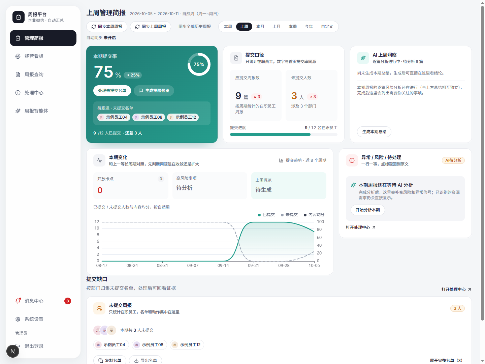
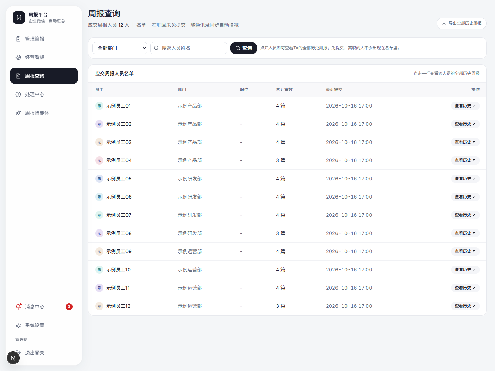
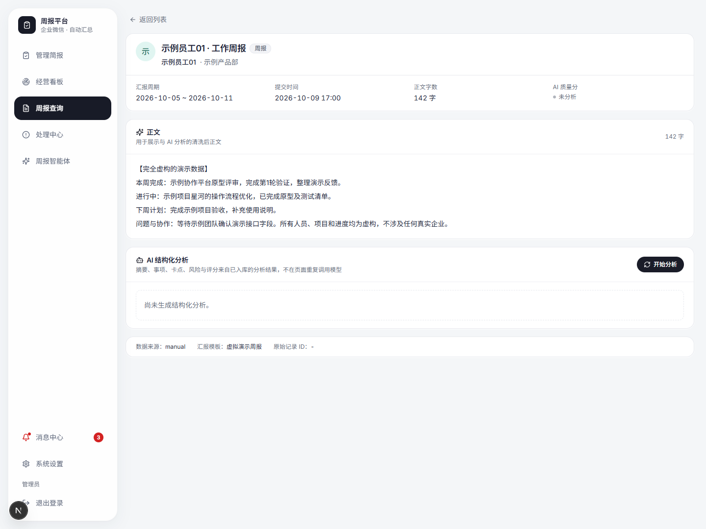

# wechat-weekreport-open

企业微信周报管理与 AI 分析平台，使用 FastAPI、SQLAlchemy 和 Next.js。
支持周报同步、提交统计、管理跟进、AI 分析与周期总结。

## 界面预览（全部为虚构数据）

以下截图来自独立内存演示数据库，包含 3 个示例部门、12 位示例员工和 45 篇虚构周报。
截图未连接真实企业微信、公司数据库或真实模型服务；人员、项目、工作内容与统计均为虚构。
AI 尚未分析的状态如实保留，不代表真实模型生成结果。

### 管理简报

### 周报查询

### 周报详情

## 本地运行

需要 Python 3.11、Node.js 22。默认数据库为 SQLite。

1. 复制 `.env.example` 为 `.env`，填写你自己的配置；不要提交真实凭据。
2. 安装后端依赖：`python -m pip install -r backend/requirements.txt`。
3. 在 `backend` 目录运行 `python -m alembic upgrade head` 初始化本地数据库。
4. 在 `backend` 目录运行 `python -m uvicorn app.main:app --host 127.0.0.1 --port 8010`。
5. 在 `frontend` 目录运行 `npm ci` 和 `npm run dev`，访问 http://localhost:3000。
6. 后台任务需在 `backend` 目录另行运行 `python -m app.worker`。

无真实模型密钥时可设置 `AI_PROVIDER=fake`。企业微信集成需要自己的自建应用及相关权限。
自动同步与自动催交默认关闭；启用前核对收件人和业务规则。

## 验证

根目录运行 `python -m pytest -q -p no:cacheprovider`。
前端目录运行 `npm run typecheck`；可用 `node --test tests/monthly-issues.test.cjs` 验证月度展示逻辑。

## 配置与部署

`.env.example` 仅含占位值。生产部署必须设置强管理员密码、稳定的随机会话密钥和配置加密密钥，启用 HTTPS 与安全 Cookie。
`deploy/` 提供部署模板；部署脚本中的 仓库地址必须替换为自己的 Fork 地址。
本副本不携带原仓库历史、公司资料、数据库、日志或真实验收材料。

## 许可证

MIT，见 LICENSE。第三方依赖继续遵循各自许可证。
