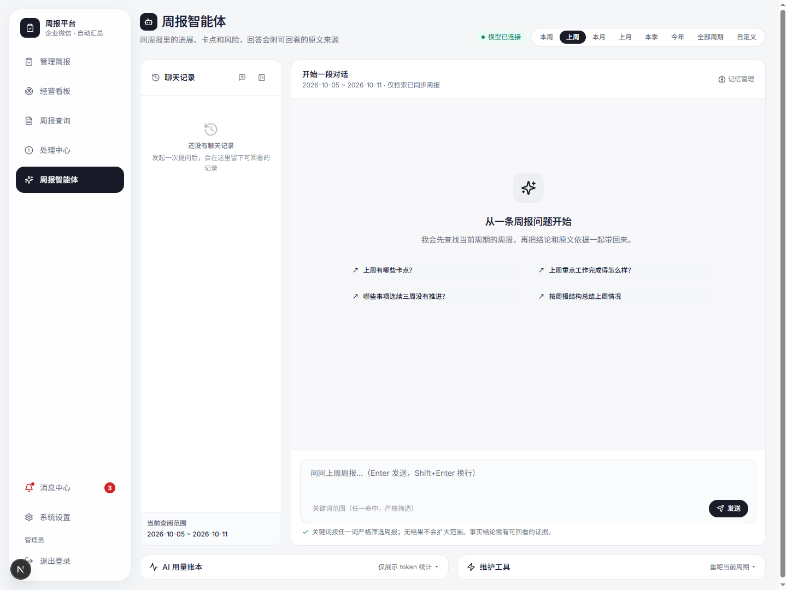

# wechat-weekreport-open

企业微信周报管理与 AI 分析平台，使用 FastAPI、SQLAlchemy 和 Next.js。
支持周报同步、提交统计、管理跟进、AI 分析与周期总结。

## 功能介绍

### 1. 管理简报：先看提交情况，再处理问题

- 按本周、上周、本月、上月、本季、今年或自定义区间查看数据。
- 查看提交率、已提交人数、未提交名单、部门提交缺口和近期提交趋势。
- 从未提交名单进入员工周报，生成催交预览、复制或导出名单。
- 查看周期总结、开放卡点、高风险事项及相关原文入口；未分析、生成中和失败状态会单独提示。
- 统计会考虑在职状态、个人免提交和部门免提交配置，减少不需要交周报的人员对统计的干扰。

### 2. 经营看板：从周报中看进展、共性问题与管理介入

- 支持总览与每月视图，按所选周期查看业务情况。
- 每月视图分为“经营情况”和“问题与介入”两页，分别展示重点推进、近期变化、部门情况，以及共性问题、管理介入、卡点和异常。
- 保留来源周报链接，方便从结论回看证据。
- 已有简报过期时仍显示旧结论并提示更新；可以主动重新生成，避免把历史结论误认为最新结果。

### 3. 周报查询：按员工查历史，按原文核实结论

- 从部门和人员姓名查找员工，查看累计周报数、最近提交时间及历史周报。
- 详情展示周期、提交时间、正文、来源和模板信息，以及已生成的结构化分析。
- 支持日报、周报、月报等类型的识别与查询，支持历史周报导出。
- 保留原始正文与清洗后正文；模型结论独立保存，便于核对而不覆盖原文。

### 4. 周报智能体：带周期范围和原文来源的问答

可以围绕已经同步的周报提问，例如：

| 想了解的情况 | 示例问题 |
| --- | --- |
| 工作进展 | 上周重点工作完成得怎么样？ |
| 提交情况 | 上周哪些人还没有提交周报？ |
| 卡点与风险 | 哪些部门的卡点较多？有哪些事项需要关注？ |
| 持续未推进 | 哪些事项连续三周没有推进？ |
| 周期复盘 | 按完成事项、下周计划和问题总结上周情况。 |

- **限定查询范围**：选择周期或自定义日期，也可查询全部周期；支持关键词范围筛选，页面展示当前查询范围。
- **按问题选取数据方式**：较小范围可读取完整原文；较大范围采用检索、分页或分批阅读，提交人数等统计通过结构化查询取得。
- **回答可核对**：回答支持原文引用和来源查看；证据不足时仍需回到周报确认。
- **连续对话**：支持追问、历史会话、新对话、删除会话及恢复历史内容。
- **执行反馈**：流式展示回答和处理进度；长任务或异常会给出状态反馈。
- **记忆与反馈**：管理公司规则、术语、回答偏好和项目背景，并对回答提交反馈。
- **用量查看**：页面提供模型用量信息，辅助了解调用消耗。

智能体只查询有权限访问且已入库的材料。真实问答需要配置兼容的模型服务；`fake` 是测试替身，不具备真实推理能力。全文与分批阅读会受上下文预算及模型能力限制。

### 5. 处理中心：把问题转成可跟进的事项

- 汇集卡点、风险及需要跟进的工作，支持查看详情和来源证据。
- 创建管理跟进事项、指定负责人，并通过企业微信发送跟进消息。
- 支持负责人查看“发给我的事项”、回复沟通和更新处理状态，形成发现问题到反馈处理的路径。
- 真实企微投递需要配置应用凭据、发送权限、可访问的页面地址与正确的收件人。

### 6. 同步与催交：后台执行，前台查看结果

- 通过企业微信接口同步部门、员工和汇报；也支持只同步周报。
- 支持本周期、上一周期、近期历史和完整历史等抓取范围。
- 同步与 AI 分析进入后台队列，重复抓取按记录及内容变化处理，避免重复入库与无变化时重复分析。
- 配置周报固定抓取时间、抓取后周期总结及自动催交；手动催交可先预览名单。
- 查看任务状态、失败原因、后续运行时间，并进行企微连通性检测。
- **自动同步、自动催交默认关闭**；调度和队列依赖独立 Worker 常驻。

### 7. 登录、权限、消息与配置

| 角色 | 使用范围 |
| --- | --- |
| 公司管理员 | 公司级数据、管理功能和系统配置 |
| 部门管理员 | 授权部门的数据及允许的管理操作 |
| 普通成员 | 发给自己的事项与沟通处理 |

- 支持访问密码和企业微信登录，按部门树配置授权与角色。
- 系统设置按同步与抓取、周报规则、AI 与翻译分类，支持个人和部门免提交。
- 模型密钥加密保存、不回显；支持模型列表探测及最近调用错误提示。
- 支持百度翻译配置；相关能力需要单独配置服务凭据。
- 消息中心集中展示同步失败、AI 调用问题及待处理提醒，支持查看状态与已读管理。

## 界面预览（全部为虚构数据）

以下截图来自独立内存演示数据库，包含 3 个示例部门、12 位示例员工和 45 篇虚构周报。
截图未连接真实企业微信、公司数据库或真实模型服务；人员、项目、工作内容与统计均为虚构。
AI 尚未分析的状态如实保留，不代表真实模型生成结果。

### 管理简报

### 周报查询

### 周报详情

### 周报智能体

展示周期选择、问题建议、聊天记录、记忆管理、关键词范围与输入区域。
本图为 `fake` 测试模式下的实际初始页面；“模型已连接”只代表测试提供者可用，未连接真实模型，也未伪造模型回答。

## 本地运行

需要 Python 3.11、Node.js 22。默认数据库为 SQLite。

1. 复制 `.env.example` 为 `.env`，填写你自己的配置；不要提交真实凭据。
2. 安装后端依赖：`python -m pip install -r backend/requirements.txt`。
3. 在 `backend` 目录运行 `python -m alembic upgrade head` 初始化本地数据库。
4. 在 `backend` 目录运行 `python -m uvicorn app.main:app --host 127.0.0.1 --port 8010`。
5. 在 `frontend` 目录运行 `npm ci` 和 `npm run dev`，访问 http://localhost:3000。
6. 后台任务需在 `backend` 目录另行运行 `python -m app.worker`。

无真实模型密钥时可设置 `AI_PROVIDER=fake`。企业微信集成需要自己的自建应用及相关权限。
自动同步与自动催交默认关闭；启用前核对收件人和业务规则。

## 验证

根目录运行 `python -m pytest -q -p no:cacheprovider`。
前端目录运行 `npm run typecheck`；可用 `node --test tests/monthly-issues.test.cjs` 验证月度展示逻辑。

## 配置与部署

`.env.example` 仅含占位值。生产部署必须设置强管理员密码、稳定的随机会话密钥和配置加密密钥，启用 HTTPS 与安全 Cookie。
`deploy/` 提供部署模板；部署脚本中的仓库地址必须替换为自己的 Fork 地址。
本副本不携带原仓库历史、公司资料、数据库、日志或真实验收材料。

## 许可证

MIT，见 LICENSE。第三方依赖继续遵循各自许可证。
